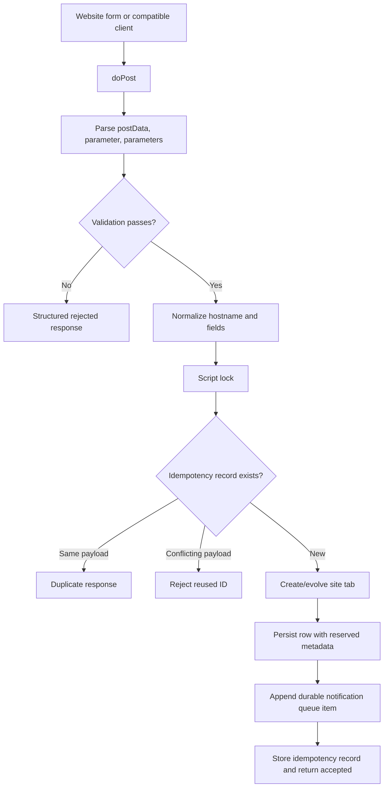
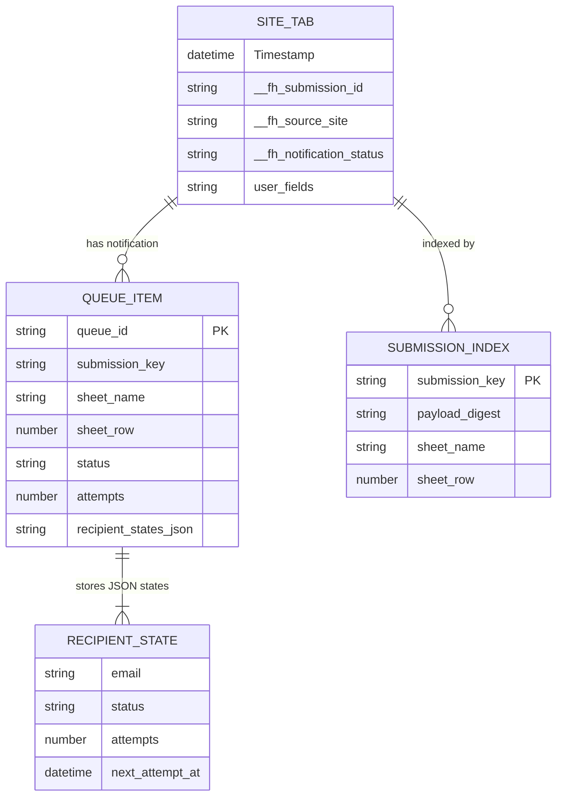

# Project Handover & Cognitive Continuity Document 🧠

> This is the authoritative handover for the FormHarbour Google Apps Script backend. Read it together with `.agents/AGENTS.md` before changing the implementation.

## 1. 🎯 Executive Summary & Project Purpose

- **Project Name**: FormHarbour universal form backend
- **Core Value Proposition**: One Google Apps Script Web App endpoint accepts form submissions from multiple websites, stores each website in its own dynamically evolving Google Sheet tab, and sends recoverable per-recipient notifications.
- **Target Audience / End Users**: Website owners who need a lightweight contact/form backend without operating a separate server or database.
- **Repository Root**: `E:\Yug Storage\Desktop\Yug Study\Programming\FormHarbour`
- **Current Operational Status**: Initial implementation complete; requires a real Spreadsheet ID and notification addresses before deployment.

## 2. 🧰 Technology Stack & Runtime Toolchain

| Layer | Technology | Role |
| :--- | :--- | :--- |
| Runtime | Google Apps Script V8 / JavaScript | Web App endpoint, editor functions, and time-driven worker |
| Persistence | Google Sheets via `SpreadsheetApp` | Website tabs, queue, idempotency index, and diagnostics |
| Notifications | `MailApp` | Individual per-recipient messages with quota checks |
| Concurrency | `LockService` | Script-wide critical sections for Sheets and shared state |
| Short-lived controls | `CacheService` | Best-effort hostname throttling |
| Durable state | `PropertiesService` | Idempotency records, queue counters/cursor, quota accounting |

There is no local package manager, server process, or external database. The project is copied into an Apps Script project and deployed as a Web App.

## 3. 🗺️ Directory Structure & Codebase Map

```text
FormHarbour/
├── Code.gs                 # Complete Apps Script backend
├── package.json            # npm test command for the local harness
├── tests/
│   └── Code.test.js        # Dependency-free mocked Apps Script behavior suite
├── test-form/
│   ├── index.html          # Local endpoint test form
│   ├── config.js           # Deployed /exec URL and optional local site override
│   ├── app.js              # Form submission, stable retry IDs, and response handling
│   └── styles.css          # Responsive visual system
│   └── assets/
│       └── formharbour-logo.png # Shared transparent logo and favicon asset
├── README.md               # Setup, deployment, integration, and limitations
├── docs/
│   ├── HANDOVER.md         # This document
│   └── SETUP.md            # Complete deployment and operations guide
├── .version_history/
│   └── VERSION_TASKS.md    # Task execution record
└── .agents/                # Repository-local agent rules and templates
```

### Key public functions

- `doPost(e)`: Parses a Web App event and returns a JSON body describing accepted, duplicate, rejected, retryable, or failed handling.
- `setup()`: Validates configuration, initializes hidden system tabs, checks MailApp, and creates exactly one one-minute queue trigger plus one spreadsheet-change structure trigger.
- `testSubmission()`: Performs a validation-only dry-run; it never writes a production row or sends email.
- `processPendingNotifications()`: Claims and sends bounded individual recipient deliveries outside spreadsheet locks.
- `checkSystemHealth()`: Returns concise administrator diagnostics.

## 4. 🔁 End-to-End Execution Flows & Runtime Architecture

### Submission flow



### Notification flow

```mermaid
sequenceDiagram
  participant Trigger as Time-driven trigger
  participant Worker as processPendingNotifications
  participant Queue as __FH_QUEUE
  participant Site as Website sheet
  participant Mail as MailApp
  Trigger->>Worker: Start bounded run
  Worker->>Queue: Claim one eligible recipient with lease
  Worker->>Site: Read persisted submission for email content
  Worker->>Mail: Send to exactly one recipient
  Mail-->>Worker: Success or exception
  Worker->>Queue: Mark sent, retry, or failed
  Worker->>Site: Update aggregate notification status
  Note over Worker,Queue: Expired leases become retryable; exactly-once delivery is impossible to guarantee.
```

## 5. 💾 Persistence Architecture

Every website gets a tab named after its normalized hostname, or a deterministic hash-suffixed name when the hostname is longer than Sheets’ 100-character tab-name limit. Website tabs use Google Forms-style order: `Timestamp` first, user fields next, then reserved `__fh_` operational columns. User fields are appended; existing order and existing row values are preserved.

Hidden system tabs:

- `__FH_QUEUE`: queue lifecycle and JSON recipient states (`pending`, `processing`, `retry`, `sent`, `failed`).
- `__FH_INDEX`: operational submission index containing digest, sheet, row, and timestamp.
- `__FH_LOG`: bounded event log without raw request bodies or form values.



## 6. 🧭 Architectural Restraints & Decisions

1. **No secrets in browser code**: `_site` is only a routing hint and is explicitly not treated as authentication.
2. **Persist before mail**: Mail is never attempted until the website row and queue state exist. A mail failure cannot delete a saved submission.
3. **Per-recipient privacy and recovery**: Recipients are sent individually and stored only in hidden operational queue state, not public response data or website tabs.
4. **Script-level locking**: Spreadsheet mutations and shared quota/idempotency state are protected by bounded `LockService` acquisition. Mail sending happens after the lock is released.
5. **Formula and content injection defense**: User values are bounded, HTML-escaped for HTML mail, and prefixed with an apostrophe before Sheets writes when they look like formulas.
6. **Conservative quota accounting**: Actual `MailApp` remaining recipient quota, a rolling 24-hour application event budget, in-flight reservations, and the configured reserve percentage are combined. Account-wide guarantees are impossible when other scripts send mail.
7. **Platform limitations are explicit**: The implementation does not claim unrestricted CORS, arbitrary HTTP status headers, preflight support, or mathematically exactly-once email delivery.

## 7. 📌 Explicit User Preferences & Working Directives

- Deliver the requested root files as `Code.gs` and `README.md`.
- Put editable configuration placeholders at the top of `Code.gs`; do not ask for configuration values in chat.
- Do not run `git add`, `git commit`, or `git push` unless the user explicitly asks.
- Prefer built-in Apps Script services and keep the deployment lightweight.
- Never expose stack traces, full request bodies, or complete recipient lists through public responses.

## 8. 🛡️ Defensive Hardening & Graceful Fallbacks

| Area | Protection / fallback |
| :--- | :--- |
| Input | JSON/form parsing, size/field/value limits, Unicode support, repeated-key preservation, reserved-name checks, honeypot, malformed-input rejection |
| Website routing | Hostname validation, `www.` normalization, subdomain preservation, deterministic long-name hashing, bounded new-tab creation |
| Spreadsheet safety | Script lock, collision detection, append-only row writes, dynamic headers, formula-prefixing, flush before critical release |
| Idempotency | Website-scoped ID plus payload digest, 14-day property retention, conflict rejection, duplicate response |
| Abuse | Best-effort CacheService hostname throttling and queue/tab caps; user-controlled hostname is not trusted identity |
| Mail | Individual recipient states, practical validation/deduplication, HTML escaping, recipient quota reserve, bounded retries with jitter |
| Recovery | Durable queue, processing leases, expired-lease recovery, rolling quota accounting, terminal status retention |
| Failure response | Structured JSON body; storage/lock failures are retryable and never falsely reported as stored |

## 9. 📍 Current Status, Roadmap & Known Limitations

### Implemented and statically verified

- [x] Universal JSON and URL-encoded `doPost` handling.
- [x] Per-hostname Sheets tabs with schema evolution.
- [x] Idempotency, reserved metadata, formula-injection protection, and best-effort throttling.
- [x] Durable individual-recipient queue with leases, retries, quota protection, and health diagnostics.
- [x] Setup, dry-run test, deployment README, and browser integration example.
- [x] README explicitly documents required form integration fields and exact hostname handling.
- [x] Notifications include a formatted HTML/plain-text site header and complete submitted-field table with size-limit markers.
- [x] Notifications set a clear sender display name, subject hostname, and semantic HTML submission headings.
- [x] Dependency-free Node test harness passes all 17 behavioral scenarios.
- [x] Only five Apps Script functions remain visible as manual entry points; internal helpers are scoped privately and the spreadsheet-change handler is a non-enumerable trigger binding.
- [x] doPost attempts a bounded recipient batch immediately after persistence, with the one-minute durable trigger as backup.
- [x] Reserved submission ID, source site, and notification status columns are protected ranges and re-aligned after schema changes.
- [x] Website header rows are protected, and renamed website tabs or edited headers are restored by the spreadsheet-change trigger.
- [x] Valid submitter email fields receive separate saved-submission confirmations through the durable queue.
- [x] Submitter email delivery and the local frontend success notice each have independent true/false configuration switches.
- [x] UUID-shaped submission IDs are displayed as compact `fh-` identifiers while preserving original-ID retry identity.
- [x] Honeypot hits are stored in protected `honeypot - <site>` review tabs without entering normal submissions or the email queue.
- [x] The local test form keeps the same submission ID across retryable/network failures and rotates it only after success.
- [x] The local test form prominently identifies the product as “FormHarbour by Yug Agarwal” and links the attribution to yugagarwal.dev.
- [x] The test client fits standard full-height desktop viewports without vertical or horizontal scrolling; shorter viewports retain safe vertical overflow instead of clipping content.
- [x] The test client uses one transparent generated FormHarbour logo asset for both the visible brand mark and favicon.
- [x] The test client header uses a prominent responsive logo size so the FormHarbour brand is immediately visible.
- [x] The test client header includes a responsive GitHub repository button linking to the FormHarbour source repository.
- [x] Local test-server instructions bind explicitly to IPv4 `127.0.0.1` to avoid the `[::]` wildcard display.
- [x] setup() and checkSystemHealth() use the script lock while mutating or recalculating shared queue state.
- [x] Node syntax check and input-validation smoke tests completed in the local workspace.

### Known limitations

- Apps Script Web Apps generally do not allow arbitrary HTTP status codes or response headers, so clients must inspect the JSON body and browser `fetch` CORS behavior remains platform-dependent.
- `_site` can be spoofed by a public client. Strong origin authentication requires a server-side integration or another trusted boundary and is intentionally not part of the basic setup.
- A crash immediately after `MailApp.sendEmail` can cause a retry and duplicate delivery; the queue makes this uncertainty recoverable but cannot remove it.
- Queue and index retention are bounded operationally, but Google Sheets is not intended for unlimited historical storage. Review/ archive old submissions for very high-volume systems.
- Honeypot capture tabs are review logs, not a replacement for an edge firewall or IP-based abuse control; `_site` remains a client-supplied routing hint.

### Next recommended work

1. Configure a real Spreadsheet ID and recipients, run `setup()`, and deploy a Web App in a test spreadsheet.
2. Exercise native form and JSON clients against the deployed `/exec` URL.
3. Monitor `checkSystemHealth()` and adjust internal defaults only if real traffic warrants it.

## 10. ✅ Incoming Agent Checklist

- [ ] Run npm test for the mocked Apps Script behavior suite.
- [ ] Read this file and `.agents/AGENTS.md` completely.
- [ ] Preserve the no-`git add`/`commit`/`push` user directive.
- [ ] Keep public configuration minimal and at the beginning of `Code.gs`.
- [ ] Run `Get-Content -Raw Code.gs | node --check --input-type=commonjs -` after code edits.
- [ ] Re-run the input-validation smoke test or equivalent focused checks.
- [ ] Update this handover and `.version_history/VERSION_TASKS.md` for architectural changes.
